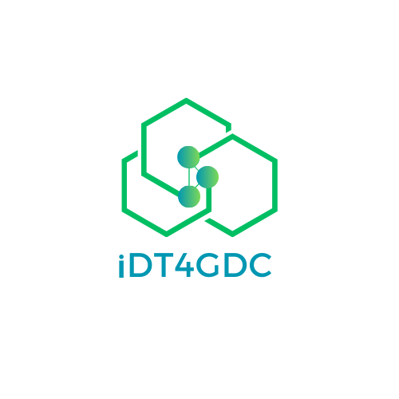

  

<h3 align="center">Intelligent Digital Twin for Green Data Centres</h3>

  EUREKA ITEA4 project SUS2022-042 · January 2024 – December 2026

  <a href="https://www.idt4gdc.com">Website</a> ·
  <a href="https://www.idt4gdc.com/results.html">Key results</a> ·
  <a href="https://itea4.org/project/idt4gdc.html">ITEA4 project page</a> ·
  <a href="https://www.linkedin.com/company/idt4gdc">LinkedIn</a> ·
  <a href="https://x.com/idt4gdc">X</a>

---

Data centres already use roughly 1% of the world's electricity, and demand for AI computing is growing fast. **iDT4GDC** is developing an open, AI-powered platform that helps data centres move towards climate neutrality through real-time digital twin simulation, machine learning optimisation and renewable energy integration. The platform addresses five pillars of sustainability (power, carbon, water, circular economy and governance) and is aligned with the EU's Climate Neutral Data Centre Pact.

## What we are building

- **Digital twin platform:** simulate and compare data centre configurations before committing to them in the real world, built on the open-source ExaDigiT and OpenDCIM systems.
- **Energy source optimisation:** a hybrid scheduling engine that selects energy sources using real-time grid signals, carbon intensity and renewable availability.
- **Green energy forecasting:** deep learning models that predict renewable energy availability hours ahead, so workloads can be scheduled into green energy windows.
- **Dynamic energy pricing and market-based allocation:** compute-job pricing that follows real-time energy cost and carbon intensity, and an auction in which software agents bid for compute capacity on behalf of operators and customers.
- **Hardware optimisation engine:** assigns compute tasks across CPUs, GPUs and FPGA accelerators at runtime without changes to the code being run, with 20–30% energy savings per inference task in early testing.
- **Integrated dashboard:** real-time and historical views of power, cooling, workloads and carbon KPIs.

All components connect through open REST APIs, so they can be integrated with existing DCIM, BMS and orchestration systems without vendor lock-in.

## Open-source repositories

| Repository | Description |
| --- | --- |
| [idt4gdc-digital-twins](https://github.com/innovaintegra/idt4gdc-digital-twins) | Reproducible, containerised reference deployments of ExaDigiT (workload and energy simulation) and OpenDCIM (physical infrastructure), connected in real time by the DT Bridge service. |
| [idt4gdc-platform](https://github.com/innovaintegra/idt4gdc-platform) | Shared backend for all work packages: Apache Airflow orchestration, FastAPI services, Celery task execution, and PostgreSQL and MongoDB storage, with Docker Compose and Kubernetes configurations. |

Both repositories are available under the MIT license. More components will be published as the project progresses towards its open-source platform release in 2026.

## Consortium

| Partner | Country | Role |
| --- | --- | --- |
| [Innova Integra](https://www.idt4gdc.com/consortium.html#innova) | United Kingdom | Project leader; system architecture, energy efficiency and mixed energy source optimisation (WP1, WP2, WP4) |
| [BitNet Bilişim](https://www.idt4gdc.com/consortium.html#bitnet) | Turkey | Green and circular energy adoption, hardware optimisation and data visualisation (WP3, WP5) |
| [Green Continuum](https://www.idt4gdc.com/consortium.html#green-continuum) | Turkey | Communication, dissemination and exploitation (WP6) |

## Get in touch

We welcome feedback, contributions, and conversations about research collaboration, pilot deployments or technology licensing. Open an issue in one of the repositories above, or contact the project leader organisation at [info@innovaintegra.com](mailto:info@innovaintegra.com).

iDT4GDC is funded by the national funding authorities of the participating countries through the EUREKA ITEA4 programme. Views expressed are those of the consortium and do not represent EUREKA or the national funding agencies.
